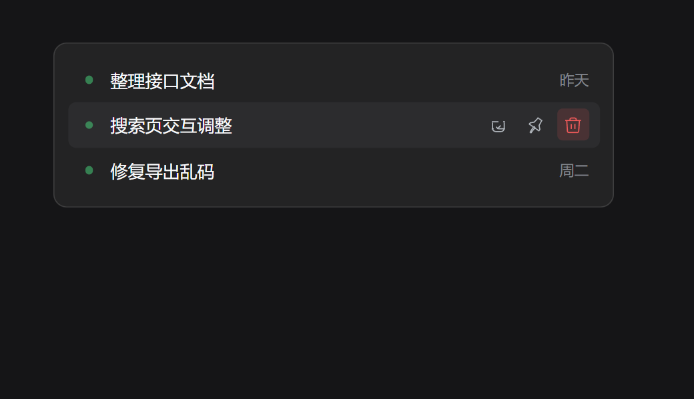
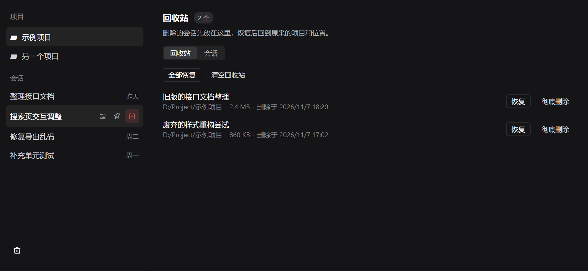
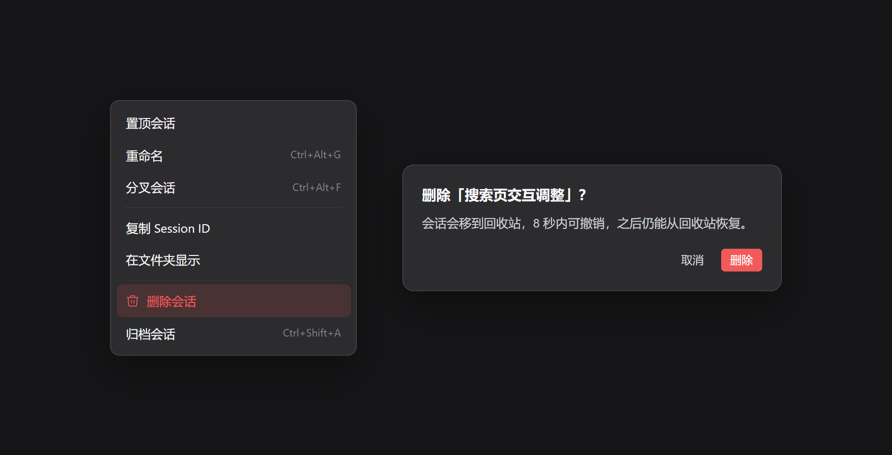

# Chat Manager

[中文](README.md) · **English**

A DeepSeek Harness plugin for deleting sessions from the sidebar. Deleted sessions go to a trash you can restore from.



## Install

In Harness, open **Plugins → Add plugin** (arrow) → **Install a third-party plugin**, then paste:

```text
github:nk33-dev/dsh-chat-manager#path:/packages/plugin
```

Enable the plugin and restart Harness. Requires Harness `0.2.2-rc.1`.

## Features

- **Delete from the sidebar**: hover a session row for the trash button; it is in the row menu too.
- **Undo**: the toast keeps **Undo** for eight seconds; after that, restore from the trash.
- **Bulk delete**: tick several rows and delete them together; running sessions are called out.
- **Trash**: the log, projection cache, and project membership move together; restore or delete permanently.
- **Workspace delete takes its sessions**: deleting a workspace sends its sessions to the trash instead of dropping them into Ungrouped.
- **Search**: filter by title, directory, or ID.

## Usage

Hover a row and click the trash button. For several at once, open the trash page, switch to **Sessions**, tick the rows, then delete.



## What delete does

Harness has archive, not delete: archiving hides a session but leaves its files on disk. This plugin does both — call the archive API, then move the log and projection cache into the trash. If archiving is refused, nothing moves.

The trash lives in `~/.dsh/chat-manager/trash/`; each entry's `manifest.json` records the original paths and position.



## Development

```sh
pnpm install
pnpm check
pnpm test
pnpm pack:plugin
```

See [Development](docs/development.md) (Chinese) for the layout and protocol, and [Validation](docs/validation.md) (Chinese) for coverage.

MIT
