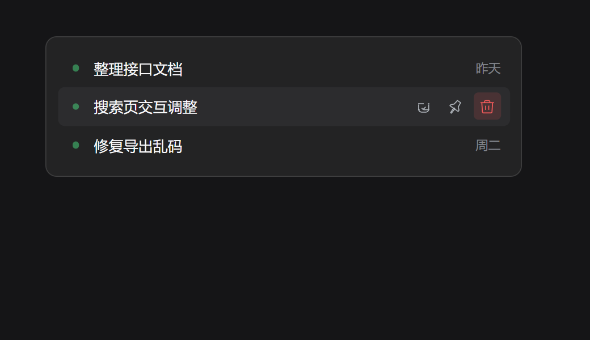
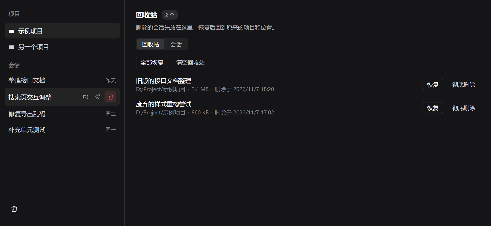
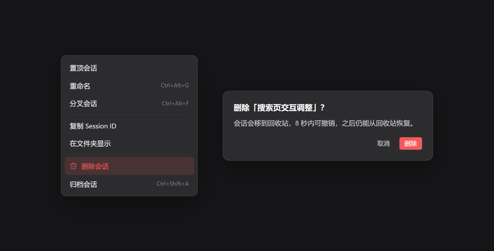

# Chat Manager

**中文** · [English](README.en.md)

DeepSeek Harness 插件。在侧边栏删会话，删掉的先进回收站，能撤销也能恢复。



## 安装

在 Harness 中打开 **插件 → 添加插件** 右侧箭头 → **安装第三方插件**，粘贴：

```text
github:nk33-dev/dsh-chat-manager#path:/packages/plugin
```

启用后重启 Harness。支持 Harness `0.2.2-rc.1`。

## 功能

- **侧栏直接删**：会话行悬停出现垃圾桶，右键菜单里也有。
- **可撤销**：提示条的「撤销」留 8 秒，错过就去回收站恢复。
- **批量删除**：勾选多个一起删，运行中的会话会单独提示。
- **回收站**：日志、投影缓存、项目归属一起移进去，可恢复可彻底删除。
- **删工作区一起清**：删工作区时，里面的会话一并进回收站，不是只挪到「未分组」。
- **搜索**：按标题、目录或 ID 过滤。

## 使用

悬停会话行点垃圾桶，确认后行消失。要批量，进回收站页的「会话」标签勾选后删。



## 删除做了什么

Harness 只有归档，没有删除：归档后侧栏不显示，文件还在磁盘。插件两步都做——先调归档接口，再把日志和投影缓存移进回收站。归档被拒绝时整体回滚。

回收站在 `~/.dsh/chat-manager/trash/`，每条的 `manifest.json` 记着原路径和位置。



## 开发

```sh
pnpm install
pnpm check
pnpm test
pnpm pack:plugin
```

结构与协议见[开发说明](docs/development.md)，验证范围见[验证记录](docs/validation.md)。

MIT
